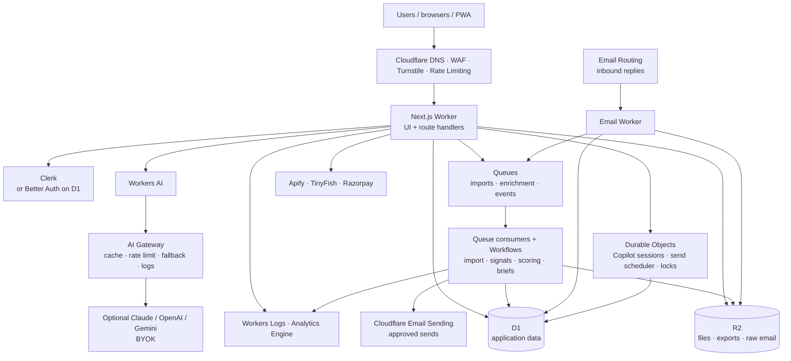

# Lead Portal: Cloudflare Migration & Architecture Plan

Status: decision draft  
Prepared: 8 November 2026  
Scope: move Lead Portal from Vercel + Supabase + per-user SMTP/IMAP to Cloudflare, with a
professional, low-cost architecture, Cloudflare AI, and Cloudflare email.

---

## 1. Executive summary

Lead Portal can run on Cloudflare, but it is not a lift-and-shift. The application is a
Next.js 16 App Router app with 33 API routes, 41 Postgres tables, 13 Postgres functions,
41 RLS policies, 62 JSONB columns, 86 UUID columns, Clerk auth, per-user SMTP/IMAP email,
Razorpay billing, and external Apify/TinyFish research.

Three decisions dominate the migration:

1. **Database:** D1 (SQLite, fully Cloudflare) requires a data-layer rewrite. Hyperdrive
   with an external Postgres keeps the existing schema and RLS but leaves a database
   outside Cloudflare.
2. **Email:** Cloudflare Email Service can send only from domains onboarded to your
   Cloudflare account. It cannot impersonate a customer's Gmail/Outlook mailbox. A
   shared sending domain, or Gmail/Microsoft Graph OAuth, is required for per-user
   outreach.
3. **Auth:** Cloudflare Access is Zero Trust access control, not a public B2B signup
   system. Keep Clerk, or self-host Better Auth on D1/Workers for a fully native stack.

Recommended path:

- **Production baseline:** Workers Paid at **$5/month**. The free Workers plan is useful
  for development, but its 10 ms CPU limit and lack of outbound email make it unsuitable
  for this app.
- **Target:** one Cloudflare account for compute, storage, queues, AI, email, and
  observability; D1 for application data, R2 for files and raw email, Queues/Workflows
  for background work, Workers AI + AI Gateway for inference.
- **Delivery strategy:** do not big-bang. First move compute and email to Cloudflare while
  keeping Postgres through Hyperdrive. Then migrate to D1 behind a tested repository
  layer. This gives a working production system at every step.

Expected run cost at current usage: **$5–15/month** plus external Apify/Razorpay usage.
At 50,000 outbound emails/month: roughly **$21/month** for email + Workers. At 100,000:
roughly **$39/month** for email + Workers, before AI and external APIs.

---

## 2. Current system assessment

### Application

- Next.js 16.3.8, App Router, React Server Components, Server Actions.
- 33 route handlers under `src/app/api`.
- Clerk authentication and invitation flows via `src/proxy.ts`.
- Supabase used as Postgres through PostgREST; no Supabase Storage or Realtime usage.
- Email: Nodemailer over per-user SMTP; IMAP sync via Imapflow; encrypted credentials.
- AI: Vercel AI SDK with OpenCode Go (DeepSeek V4.1 Flash), OpenAI, Google, or Groq
  fallbacks.
- External services: Apify actors for Crunchbase/Apollo/LinkedIn, TinyFish probe,
  Razorpay subscriptions, optional Slack/Discord integrations.
- Background work: Vercel cron once daily (`/api/worker/tick`), in-process queue on the
  `jobs` table, campaign sends, signal scans, and send-coin queue.

### Database

- 41 tables, 13 SQL functions, 41 RLS policies, 21 identity columns, 66 timestamptz
  columns, 86 UUIDs, 62 JSONB columns, 13 text[] columns.
- Current data volume is small (hundreds of companies/contacts, thousands of messages),
  so data export is easy; schema and query-porting effort is the real cost.
- RLS is used for workspace isolation. D1 has no RLS; authorization must move into the
  server/data layer.

### Migration blockers to call out early

| Blocker | Why it matters | Decision |
|---|---|---|
| Per-user SMTP/IMAP | Workers do not run Nodemailer/Imapflow reliably; Cloudflare Email Sending only sends from onboarded domains | Shared sending domain or Gmail/Microsoft Graph OAuth |
| RLS | D1/SQLite has no Postgres RLS | Enforce workspace scoping in a repository layer |
| Postgres features | JSONB, arrays, UUID, timestamptz, functions | Convert to SQLite types and TypeScript logic |
| Clerk middleware | `proxy.ts` uses Node middleware; Cloudflare Next adapters differ | Spike OpenNext and vinext before choosing |
| Next.js adapter | vinext is Cloudflare-recommended but beta; OpenNext is mature but has its own limits | Use OpenNext for the first production cut, evaluate vinext |
| Native Node modules | Nodemailer, Imapflow, native image processing | Replace or isolate |
| Outbound email compliance | Cold outreach needs SPF/DKIM/DMARC, warm-up, suppression, reply handling | Keep the existing send-coin policy and deliverability rules |

---

## 3. Target architecture



Optional bridge during migration:

```text
Next.js Worker --Hyperdrive--> External Postgres (Neon / Supabase / PlanetScale)
```

Hyperdrive is a Cloudflare connection pool and cache in front of Postgres. It preserves
the current SQL and RLS model, but the database remains outside Cloudflare.

### Component responsibilities

- **Web Worker:** Next.js rendering, auth, APIs, thin orchestration. No long-running work.
- **Queues:** durable handoff for imports, enrichment, signal scans, email events,
  analytics events, and AI jobs. Consumers retry independently.
- **Workflows:** multi-step, long-running jobs that need durable state: deep research,
  agent plans, multi-company imports, campaign ticks. Free plan includes 3,000 steps/day.
- **Durable Objects:** one per Copilot conversation and one per workspace send scheduler.
  SQLite-backed state, alarms for delayed work, idempotent send locks. Free plan supports
  SQLite-backed objects.
- **D1:** normalized application data, workspace-scoped. Keep raw MIME and large bodies in
  R2; store pointers and searchable metadata in D1.
- **R2:** email attachments, raw messages, CSV exports, uploaded logos, backups. No egress
  fees; 10 GB/month free.
- **Workers AI + AI Gateway:** cheap classification, extraction, embeddings, summaries,
  and drafting; gateway for caching, rate limits, fallback, and optional Claude.
- **Email Routing + Email Worker:** inbound replies on the sending domain, threading,
  stop-on-reply, suppression, and queue handoff. Email Routing inbound is free.
- **Cloudflare Access:** protect internal admin/super-admin surfaces only; not a customer
  auth system.

---

## 4. Cloudflare product mapping and free-tier reality

| Current | Cloudflare target | Free allowance | Production note |
|---|---|---|---|
| Vercel hosting | Workers + Static Assets | 100k requests/day, 10 ms CPU | Paid $5 gives 10M requests and 30M CPU-ms; needed for real Next.js SSR |
| Next.js runtime | vinext or OpenNext on Workers | Included with Workers | Spike both; existing app likely starts with OpenNext |
| Supabase Postgres | D1 or Hyperdrive + Postgres | D1 5 GB, 5M reads/day, 100k writes/day; Hyperdrive 100k queries/day | D1 is native but requires SQLite rewrite; Hyperdrive is fastest |
| Supabase RLS | Application-level workspace scoping | N/A | Build a repository layer + tests; no database RLS |
| Supabase storage (not used) | R2 | 10 GB, 1M Class A, 10M Class B, free egress | Use lifecycle rules for raw email |
| Vercel cron / jobs table | Cron Triggers + Queues + Workflows + DO alarms | Queues 10k ops/day; Workflows 100k req/day, 3k steps/day; DO 100k req/day | Paid allowances are generous; use DO for per-minute send scheduling |
| SMTP/IMAP email | Email Sending + Email Routing + Email Workers | Inbound unlimited; outbound only Workers Paid, 3k/month included, $0.35/1k after | Shared domain required; no Gmail impersonation |
| AI SDK providers | Workers AI + AI Gateway | 10k Neurons/day; gateway core free | Free models for extraction/classification; paid/frontier models for high-stakes drafting |
| Vector search (future) | Vectorize | 30M queried dimensions, 5M stored dimensions/month | Free is enough for initial semantic lead search |
| Scraping | Keep Apify; Browser Run for light checks | Browser Run 10 min/day | 10 min/day is not enough for production scraping; keep Apify |
| Payments | Razorpay (external) | N/A | Works from Workers via fetch and HMAC verification |
| Auth | Clerk or Better Auth on D1 | Clerk free tier; Better Auth open source | Access is not a public signup system |
| Logs | Workers Logs + Analytics Engine | 200k log events/day, 100k data points/day | Add alerts and Tail Worker for errors |

### Free-tier truth

- A **$0/month** stack is possible for development: Workers Free, D1 Free, R2 Free,
  Queues Free, DO Free. It is not a production plan for this app because:
  - outbound email requires Workers Paid;
  - 10 ms CPU per request is too tight for Next.js SSR;
  - daily D1/Queues/DO caps are hard failures, not overages.
- **$5/month Workers Paid** is the minimum professional baseline. It includes Workers,
  D1, R2, Queues, DO, Workflows, and 10k Workers AI Neurons/day at their included
  allowances, plus 3,000 outbound emails/month.

---

## 5. AI: what Cloudflare offers, and what is actually free

### Workers AI

- 50+ models across text, embeddings, vision, speech, and image generation.
- **10,000 Neurons/day free** on both Free and Paid plans; beyond that $0.011 per 1,000
  Neurons on Paid. Free-plan requests fail when the daily allowance is exhausted.
- Current free-eligible models worth evaluating (pin after a live check; catalog changes):
  - `@cf/qwen/qwen3.8-27b` — general text/vision, 262K context.
  - `@cf/google/gemma-4-26b-a4b-it` — efficient general text.
  - `@cf/zai-org/glm-4.7-flash` — fast multilingual text.
  - `@cf/openai/gpt-oss-120b` — stronger open-weight reasoning.
  - `@cf/meta/llama-3.3-70b-instruct-fp8-fast`.
  - `@cf/qwen/qwen3-embedding-0.6b` for embeddings.
- Several frontier models (Kimi K2.x, GLM 5.x, DeepSeek V4.x) require Workers Paid or
  prepaid AI Gateway credits. Model deprecations are frequent: 24 models are scheduled
  for removal on **20 November 2026**; pin current replacements and keep an eval suite.
- Cloudflare does not use Workers AI customer content to train its models.

### AI Gateway

- Free core features: analytics, caching, rate limiting, model fallback, logs
  (100k logs total on Free; Workers Logs-based retention on newer accounts).
- **Claude is not a Workers AI model.** Cloudflare does not host Anthropic Claude. AI
  Gateway can proxy Claude (and OpenAI/Gemini) with your own API key or gateway credits.
  Use `AI Gateway` as the single OpenAI-compatible entry point; route:
  - cheap extraction/classification/embeddings → Workers AI free models;
  - cold-email drafting/planning → best model you can afford (Claude via gateway or a
    paid Workers AI frontier model);
  - deterministic fallbacks when the model is unavailable.
- "Claude Flare" is not a Cloudflare product. The practical interpretation is
  "Claude through Cloudflare AI Gateway."

### Cost/quality guidance

- 10k Neurons/day ≈ $0.11 of inference at the paid rate. That is enough for demos and
  light internal use, but not high-volume drafting with long prompts.
- Expect **$5–20/month** of AI at moderate production usage; budget separately for
  Claude/OpenAI if you route high-value drafts there.
- Use AI Gateway caching for repeated company summaries and prompts; use structured
  JSON outputs and retries; log model, cost, latency, and quality per run.

---

## 6. Email architecture and the hard constraint

### What Cloudflare provides

- **Email Routing (inbound):** unlimited inbound mail on Free and Paid. Routes to a
  Worker, a verified destination address, or drops. Email Workers can parse, forward,
  reply, or reject. `message.reply()` preserves threading and requires a valid DMARC
  result on the incoming message.
- **Email Sending (outbound):** Workers Paid only. 3,000 emails/month included per
  account, then $0.35 per 1,000. Send via a Workers `send_email` binding, REST API, or
  authenticated SMTP. Sends to verified destination addresses are free.
- **Domains:** you can send only from domains onboarded to Email Service in your
  Cloudflare zone; up to 30 routing/sending domains per zone. There is no dedicated IP
  product listed for this service and no ability to send as an arbitrary customer mailbox.

### What this means for Lead Portal

The current product lets each member connect their own SMTP/IMAP mailbox. Cloudflare
cannot replace that one-to-one. Choose one of these product models:

1. **Recommended: platform sending domain per workspace**
   - e.g. `acme.outreach.yourdomain.com` or `outreach.yourdomain.com`.
   - Onboard the domain to Cloudflare Email Service; publish SPF, DKIM, DMARC.
   - Send approved cold emails through Email Sending; route replies back through Email
     Routing to a Worker; store threads in D1/R2; stop-on-reply and suppression stay.
   - Best deliverability control and simplest Cloudflare-native path.
   - Product change: users send from a Lead Portal address, not their Gmail.

2. **Bring-your-own mailbox via OAuth**
   - Gmail API or Microsoft Graph send/reply on behalf of the user; store OAuth tokens
     encrypted; Workers call the APIs.
   - Inbound replies via Gmail/Graph push notifications or a forwarding rule to the
     platform Email Routing address.
   - Preserves "send from my own inbox," but adds OAuth consent, token refresh, provider
     review, and per-provider rate limits.

3. **Hybrid / keep an external ESP**
   - Cloudflare Email Service for platform/transactional mail; Resend/Postmark/SES for
     customer-domain outreach. Least migration risk, but not one ecosystem.

### Deliverability and anti-spam controls to keep

- Human-approved send coins; no silent automation.
- Warm-up caps (10 → 20 → 30/day), business hours, weekdays, randomized gaps, one email
  per domain per day, 30-day contact cooldown, suppression, reply/stop checks, invalid
  email blocking, no links/HTML/spam phrases in first contact.
- Separate transactional and cold-outreach subdomains; publish SPF, DKIM, DMARC; monitor
  bounces/complaints; add unsubscribe handling for later touches.
- Store raw MIME and attachments in R2; store searchable metadata/thread IDs in D1.

---

## 7. Database decision

### Option A: D1 (fully Cloudflare)

Pros:
- One vendor, no external database bill, 5 GB free, low latency from Workers, simple
  backups/Time Travel, local SQLite development.
- Free allowances are enough for current data; Paid allowances are generous.

Cons:
- SQLite, not Postgres. No RLS, no Postgres functions, no JSONB/arrays/UUID/timestamptz.
- 41 tables, 13 functions, 41 policies, 62 JSONB and 86 UUID columns must be rewritten.
- 10 GB maximum per database; large email archives must live in R2 and be sharded/archived.
- Cross-table analytics and complex joins require redesign.
- Every Supabase query in the app (33 routes, many libraries) must move to D1/Drizzle.

Verdict: viable and aligns with "one ecosystem," but it is a **schema + data-access
rewrite**, not a database dump/restore. Estimate 3–6 weeks for a careful migration with
tests, plus cutover.

### Option B: Hyperdrive + external Postgres (fastest, lowest risk)

Pros:
- Keep the existing Postgres schema, JSONB, arrays, functions, and RLS.
- Change the connection string, use `pg`/Drizzle through Hyperdrive, deploy Workers.
- Hyperdrive Free includes 100,000 queries/day; Paid is unlimited.
- Can use Neon free/paid or PlanetScale Postgres billed through Cloudflare.

Cons:
- Database is still outside Cloudflare; not a strict one-vendor stack.
- Hyperdrive cache does not invalidate on writes; use a cache-disabled connection for
  write-after-read flows.
- Postgres region still matters; pin Worker placement near the database.

Verdict: best first production cut. It removes Vercel and Supabase hosting while keeping
the data model stable. Then decide whether D1's vendor consolidation is worth the rewrite.

### Recommended sequence

1. Move compute to Workers with **Hyperdrive → current Postgres** (or Neon).
2. Move email, AI, files, jobs, and observability to Cloudflare.
3. Build a repository layer and contract tests.
4. Migrate to D1 behind that layer, table group by table group, with dual-read/shadow
   validation and a rollback snapshot.
5. Retire Postgres only after D1 parity and load tests pass.

---

## 8. Authentication decision

- **Clerk (pragmatic):** already integrated, supports B2B organizations, invitations,
  passkeys/MFA, and works with Workers through the Next adapter. It remains one external
  dependency, but reduces migration risk. Free tier is adequate for early usage.
- **Better Auth on D1 (fully native):** open-source, runs on Workers, D1 adapter,
  email/password, OAuth, passkeys, organizations. Requires rebuilding sign-in/up,
  invitations, password reset, session handling, and migrating Clerk users.
- **Cloudflare Access (not a replacement):** use it to protect `/admin` or internal
  super-admin routes, not customer signup. Access is an identity-aware proxy; it expects
  an IdP and does not provide public self-serve B2B auth.

Recommendation: keep Clerk for the first Cloudflare cut; run a Better Auth spike in
parallel. Only migrate auth after the app, email, and data layers are stable.

---

## 9. Background jobs, agents, and scheduling

| Workload | Cloudflare primitive |
|---|---|
| Crunchbase/Apollo imports | Queue + Workflow (long-running, retryable) |
| Website enrichment | Queue consumer with concurrency limit |
| Signal scans, scoring | Cron + Queue; batch by workspace |
| AI briefs, drafts, agent plans | Queue/Workflow; model call in consumer |
| Campaign ticks | Cron every minute or DO alarm per workspace |
| Send-coin scheduler | Durable Object per workspace + alarm; D1 queue |
| Inbound email parsing | Email Worker → Queue → R2/D1 |
| IMAP replacement | Email Routing + Email Worker; no IMAP sync |
| Billing webhooks | Worker route with HMAC verification |
| Analytics rollups | Cron + Analytics Engine / D1 |

Notes:
- Cron Triggers run at most once per minute; use a DO alarm when a workspace needs an
  exact next slot.
- Queues Free: 10,000 operations/day (~3,300 messages), 24-hour retention. Paid: 1M
  operations/month, 4–14 day retention. Keep messages under 64 KB; put payloads in R2.
- Workflows Free: 3,000 steps/day, 1 GB state. Paid: 500,000 steps/month included. Good
  for multi-step imports and agent plans; not for every tiny task.

---

## 10. Cost model

Assumptions: current usage, one production workspace, small data, <3,000 outbound
emails/month.

| Item | Monthly |
|---|---|
| Workers Paid (base) | $5.00 |
| D1 (within free/paid included) | $0.00–low |
| R2 (within 10 GB) | $0.00 |
| Queues / DO / Workflows (within paid allowances) | $0.00 |
| Email Sending (≤3,000) | included |
| Workers AI (≤10k Neurons/day) | included |
| Domain | ~$1/month amortized |
| Apify / TinyFish / Razorpay | usage-based, unchanged |
| **Baseline** | **~$6–15/month** |

At higher email volume (Workers Paid):
- 10,000 emails/month: $5 + 7,000 × $0.35/1,000 = **$7.45** (plus Workers).
- 50,000 emails/month: $5 + 47,000 × $0.35/1,000 = **$21.45**.
- 100,000 emails/month: $5 + 97,000 × $0.35/1,000 = **$38.95**.
- AI beyond 10k Neurons/day: $0.011/1,000 Neurons; Claude/OpenAI via gateway is separate.
- D1 paid storage $0.75/GB-month; rows beyond included allowances are very cheap at this
  scale.
- Keep Apify/AI provider costs separate; Cloudflare does not include those credits.

A strict zero-cost setup is for development only. Production email and reliable Next.js
SSR require Workers Paid.

---

## 11. Migration phases

### Phase 0 — Feasibility spike (3–5 days)

- Create a Cloudflare account/zone; move or delegate the domain.
- Branch: run `npx vinext check`; also prototype OpenNext.
- Deploy a preview Worker with no production data.
- Verify: Clerk middleware/`proxy.ts`, RSC, Server Actions, file uploads, Razorpay HMAC,
  AI SDK calls, and any Node APIs.
- Create a Hyperdrive config to a staging Postgres.
- Exit: preview app loads, auth works, one API route reads/writes Postgres.

### Phase 1 — Compute cutover with Hyperdrive (1–2 weeks)

- Deploy production Worker behind `staging.` or a workers.dev hostname.
- Replace Vercel cron with Cron Triggers + Queues; keep existing Postgres schema/RLS.
- Move static assets and generated files to R2/Workers Static Assets.
- Add Workers Logs, Analytics Engine, and error alerts.
- Run shadow traffic; verify auth, billing, imports, email drafts, and Copilot.
- Exit: staging feature parity; rollback to Vercel one DNS change away.

### Phase 2 — Email cutover (1–2 weeks)

- Choose sending model: shared workspace subdomain (recommended) or OAuth mailboxes.
- Onboard sending domain; publish SPF/DKIM/DMARC; warm up.
- Implement Email Sending for approved sends; Email Routing + Email Worker for replies.
- Replace Nodemailer/Imapflow paths; store raw MIME in R2, threads in D1/Postgres.
- Keep send coins, suppression, cooldowns, caps, and human approval.
- Test with seed inboxes, bounce/complaint handling, and reply threading.
- Exit: outbound/inbound parity; deliverability checks pass; rollback plan documented.

### Phase 3 — AI cutover (1 week)

- Add AI Gateway; move model calls behind it.
- Workers AI for classification, extraction, embeddings, and cheap summaries.
- Use a stronger model for drafts/planning if quality requires it; compare against current
  DeepSeek/OpenCode output with an eval set.
- Cache repeated prompts; add rate limits, fallback, and cost metrics.
- Exit: quality parity on 30–50 golden cases; cost/latency within budget.

### Phase 4 — D1 migration (3–6 weeks, only if going fully native)

- Build a repository/data-access layer with Drizzle + D1.
- Convert schema: UUID→TEXT, timestamptz→TEXT/INTEGER, JSONB→TEXT JSON, arrays→JSON,
  identity→INTEGER PRIMARY KEY, functions→TypeScript, RLS→workspace-scoped repository.
- Move raw email/attachments to R2; keep D1 metadata small.
- Migrate data in dependency order; run dual-read/shadow comparisons.
- Seed workspaces, profiles, companies, contacts, emails, campaigns, coins/queue, activity.
- Load-test imports/enrichment; verify D1 daily write limits.
- Exit: row counts and checksums match; all routes pass; rollback snapshot retained.

### Phase 5 — Auth decision (1–3 weeks, optional)

- Keep Clerk if speed matters; or implement Better Auth on D1 and migrate users.
- Rebuild invitations, password reset, sessions, org/workspace membership, and webhooks.
- Exit: auth parity and security review.

### Phase 6 — Cutover and decommission (1 week)

- Lower DNS TTL; deploy production Worker; run smoke tests.
- Monitor errors, latency, queue depth, email deliverability, and AI spend.
- Keep Vercel/Supabase read-only for a rollback window.
- Decommission only after 2–4 weeks of stable production.

Total:
- **Hybrid path:** ~4–6 weeks.
- **Full Cloudflare/D1:** ~8–12 weeks, depending on auth and email model.

---

## 12. Risks and mitigations

| Risk | Impact | Mitigation |
|---|---|---|
| Next.js adapter incompatibility | High | Spike OpenNext and vinext; keep Vercel rollback; test `proxy.ts`, RSC, Actions |
| Email deliverability | High | Separate subdomain, warm-up, SPF/DKIM/DMARC, suppression, seed testing, gradual volume |
| Per-user SMTP cannot move | High | Product decision: shared domain or Gmail/Graph OAuth; do not promise Gmail impersonation |
| D1 rewrite | High | Repository abstraction, table-by-table migration, shadow reads, snapshots |
| RLS removed | High | Workspace scoping in every query + contract tests + security review |
| AI quality/cost | Medium | Golden eval set, model routing, caching, budgets, fallback |
| Free-tier hard failures | Medium | Workers Paid baseline; alerts at 70/90% of D1/Queues/AI limits |
| Vendor lock-in | Medium | D1 SQL is portable SQLite; R2 is S3-compatible; export paths documented |
| Lost inbound replies | High | Email Routing rules, R2 raw archive, queue retries, thread mapping |
| Send queue duplicate sends | High | Durable Object lock/idempotency key, unique coin_id, status transitions |
| Regional latency | Medium | Place Worker near primary DB (Hyperdrive/Postgres); D1 replication-aware reads |

---

## 13. Decisions needed before implementation

1. **Database:** full D1 rewrite, or Hyperdrive + Postgres first?
2. **Auth:** keep Clerk for speed, or self-host Better Auth on D1 for one ecosystem?
3. **Email:** shared Lead Portal sending domain (recommended), or Gmail/Outlook OAuth
   for each member?
4. **AI quality:** free Workers AI only, or paid/frontier models (Claude via AI Gateway)
   for drafting and planning?
5. **Migration window:** can the app tolerate a short read-only window for final data
   sync, or must it be zero-downtime?

---

## 14. Source notes

Pricing and limits were checked on 8 November 2026. Re-check before committing a budget.

- Cloudflare Workers pricing: https://developers.cloudflare.com/workers/platform/pricing/
- Workers AI pricing: https://developers.cloudflare.com/workers-ai/platform/pricing/
- Workers AI model catalog: https://developers.cloudflare.com/workers-ai/models/
- AI Gateway pricing: https://developers.cloudflare.com/ai-gateway/reference/pricing/
- Email Service pricing: https://developers.cloudflare.com/email-service/platform/pricing/
- Email Service limits: https://developers.cloudflare.com/email-service/platform/limits/
- Email Routing / Email Workers: https://developers.cloudflare.com/email-routing/email-workers/
- D1 pricing: https://developers.cloudflare.com/d1/platform/pricing/
- D1 limits: https://developers.cloudflare.com/d1/platform/limits/
- Queues pricing: https://developers.cloudflare.com/queues/platform/pricing/
- Durable Objects pricing: https://developers.cloudflare.com/durable-objects/platform/pricing/
- Workflows pricing: https://developers.cloudflare.com/workflows/reference/pricing/
- Hyperdrive pricing: https://developers.cloudflare.com/hyperdrive/platform/pricing/
- R2 pricing: https://developers.cloudflare.com/r2/pricing/
- Vectorize pricing: https://developers.cloudflare.com/vectorize/platform/pricing/
- Browser Run pricing: https://developers.cloudflare.com/browser-rendering/platform/pricing/
- Next.js on Cloudflare: https://developers.cloudflare.com/workers/framework-guides/web-apps/nextjs/
- vinext: https://github.com/cloudflare/vinext
- Cloudflare Access: https://developers.cloudflare.com/cloudflare-one/access-controls/
